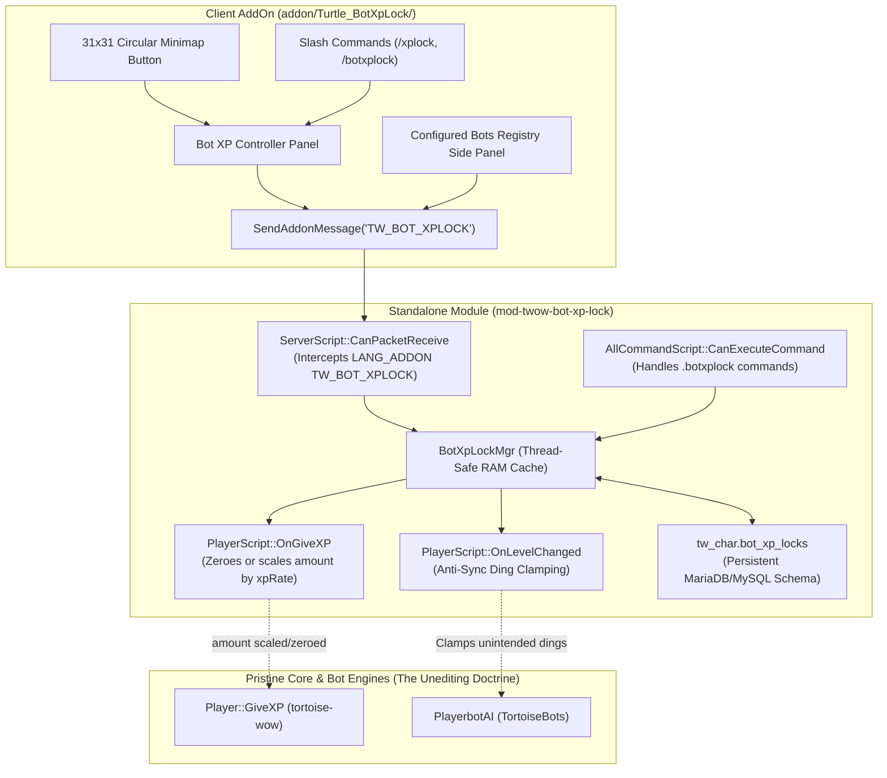

# Bot XP Lock & Rate Controller for Turtle WoW (`mod-twow-bot-xp-lock`)

[](https://turtle-wow.org)
[-blue.svg)](https://github.com/tortoise-wow/tortoise-wow)
[](https://github.com/Sagiroth/TortoiseBots)
[]()
[]()

A standalone, non-intrusive bot and companion XP locking and rate controller module with an accompanying client AddOn for **Turtle WoW custom vMaNGOS (`tortoise-wow`)** and **`TortoiseBots`**.

Allows players to **freeze individual bot XP**, **set twink bracket caps (19, 29, 39, 49, 59)**, **set custom level caps (1–60)**, or **set granular per-bot XP rates (e.g. 0.25x, 0.5x, 1.0x, 2.0x, 3.0x)** with one click via an in-game graphical controller panel, circular minimap button, or chat slash commands. Includes a dedicated **Configured Bots Registry Side Panel** to view and target all bots saved in the database with custom locks and rates.

---

## 🌟 Key Features



1. **Strict Immutability (The Unediting Doctrine)**:
   * 100% standalone module space. Zero modifications, patches, or edits to `tortoise-wow` or `TortoiseBots`.
2. **Individual Per-Bot XP Freezing & Level Caps**:
   * **Freeze XP Now**: Locks bot at its exact current level (0x XP).
   * **Twink Bracket Caps (19, 29, 39, 49, 59)**: Quick-cap buttons for standard PvP brackets.
   * **Custom Level Cap (1–60)**: Numeric input box and "Set Custom Cap" button to stop leveling at any arbitrary level.
   * **Automatic Lock on Ding**: Bot levels naturally until reaching the target cap, where XP is automatically locked and the master is notified.
3. **Granular Individual XP Rates**:
   * Sets individual XP rate multipliers per bot (e.g., `0.25x` very slow, `0.5x` half-speed leveling, `1.0x` normal, `2.0x` double, `3.0x` triple).
   * Modifies XP directly in `PlayerScript::OnGiveXP(Player* player, uint32& amount, Unit* victim)`.
4. **Configured Bots Registry Side Panel**:
   * Toggleable side window listing all bots saved in `bot_xp_locks` with their level, lock state, and custom rate.
   * Paged display (`< Prev` / `Next >`) with direct click-to-target selection button for each entry.
5. **Triple-Layer XP Suppression**:
   * **Layer 1 (`PlayerScript::OnGiveXP`)**: Passes `amount` by reference. When locked, `amount = 0` causes `Player::GiveXP` to return immediately (`if (xp < 1) return;`), blocking kill XP, quest XP, and discovery XP.
   * **Layer 2 (Native Core Flag)**: Invokes `bot->SetXPGain(false)` natively, suppressing exploration XP and `SMSG_LOG_XPGAIN` packet distribution.
   * **Layer 3 (Anti-Sync Ding Protection)**: In `TortoiseBots`, `AiPlayerbot.SyncAltLevelToMaster` can force alt bots to ding to match their master. `BotXpLockMgr::OnLevelChanged` detects any ding exceeding the locked cap and immediately clamps the bot back to its target bracket level with fresh stats and zero excess XP.
6. **Optimized, Silent Client AddOn (`Turtle_BotXpLock`)**:
   * Strict Vanilla 1.12.1 / Lua 5.0 runtime compliance (zero `#` length operators, zero `%` modulo operators, zero `string.match`).
   * **Silent Polling**: Targeting or selecting bots performs 100% silent wire queries (`SendAddonMessage`); zero chat frame spam upon clicking players or bots.
   * **Resource Efficient**: No background `OnUpdate` polling loops; queries only run when the controller window is actively open.
   * **Minimap Button**: Circular 31x31 Vanilla standard icon with drag positioning and tooltips (Left-Click to quick-toggle targeted bot XP, Right-Click / Shift-Click to open controller).

---

## 💻 Commands

Players and Game Masters can manage bot XP locks and rates using either the graphical controller panel or chat slash commands:

| Command | Description |
| :--- | :--- |
| `/xplock` or `/botxplock` | Opens or closes the Bot XP Controller panel. |
| `/xplock lock` or `.botxplock lock` | Locks XP immediately for the targeted bot at its current level (0x XP). |
| `/xplock lock <level>` or `.botxplock lock <level>` | Sets a custom level cap (e.g. `19`, `29`, `39`, `49`, `59`, or any level 1–60). |
| `/xplock rate <mult>` or `.botxplock rate <mult>` | Sets individual XP rate (e.g. `0.5` for half XP, `2.0` for double XP). |
| `/xplock unlock` or `.botxplock unlock` | Restores normal XP progression (1.0x) for the targeted bot. |
| `/xplock list` or `.botxplock list` | Opens the Configured Bot Registry panel (or prints in chat for GM console). |
| `.botxplock status` | Queries detailed XP status, rate, and progression for the targeted bot. |

---

## ⚙️ Configuration (`conf/mod-twow-bot-xp-lock.conf.dist`)

```ini
[BotXpLock]
# Master switch for the module (1 = enabled, 0 = disabled)
BotXpLock.Enable = 1

# Restrict XP locking and rate modifications to bots in the player's group (1 = yes, 0 = no)
BotXpLock.PartyOnly = 0

# Allow players to set custom numeric level caps between 1 and 60 (1 = yes, 0 = no)
BotXpLock.AllowCustomCap = 1

# Automatically clamp alt-sync dings back to the bot's configured level cap (1 = yes, 0 = no)
BotXpLock.ClampAltSyncDing = 1

# Send a chat notification to the master player when a bot reaches its level cap and locks (1 = yes, 0 = no)
BotXpLock.NotifyOnLock = 1
```

---

## 🗄️ Database Schema (`data/sql/character/characters_bot_xp_locks.sql`)

The module automatically creates and manages table `bot_xp_locks` in the character database (`tw_char`):

```sql
CREATE TABLE IF NOT EXISTS `bot_xp_locks` (
    `guid` INT UNSIGNED NOT NULL COMMENT 'Character low GUID of the bot',
    `locked` TINYINT UNSIGNED NOT NULL DEFAULT 1 COMMENT '1 = locked, 0 = unlocked',
    `lock_level` TINYINT UNSIGNED NOT NULL DEFAULT 0 COMMENT '0 = lock at current level; >0 = cap at this level',
    `locked_at_level` TINYINT UNSIGNED NOT NULL DEFAULT 0 COMMENT 'Level when lock was applied',
    `xp_rate` FLOAT NOT NULL DEFAULT 1.0 COMMENT 'Individual bot XP rate multiplier (e.g. 0.5, 1.0, 2.0)',
    `locked_by_guid` INT UNSIGNED NOT NULL DEFAULT 0 COMMENT 'Player low GUID who applied the lock',
    `locked_at` DATETIME NULL COMMENT 'Timestamp when lock was last modified',
    PRIMARY KEY (`guid`)
) ENGINE=InnoDB DEFAULT CHARSET=utf8mb4 COMMENT='Turtle WoW Bot XP Lock & Rate State Registry';
```

---

## 📦 Installation

1. Place `mod-twow-bot-xp-lock` in `Source/tortoise-wow/modules/mod-twow-bot-xp-lock`.
2. Configure CMake with `-DMODULES=static` and build the server.
3. Copy `conf/mod-twow-bot-xp-lock.conf.dist` to `Server/etc/modules/mod-twow-bot-xp-lock.conf`.
4. Copy `addon/Turtle_BotXpLock` into your game client's `Interface/AddOns/` directory.
