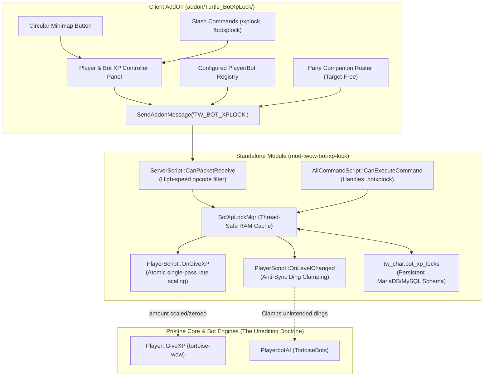

# Player & Bot XP Controller for Turtle WoW (mod-twow-bot-xp-lock)

A standalone, non-intrusive player and bot XP locking, level capping, and rate management module with an accompanying client AddOn for Turtle WoW custom vMaNGOS (tortoise-wow client 1.18.1 / 1.12.1) and TortoiseBots.

Allows players to freeze individual player or bot XP, set twink bracket caps (19, 29, 39, 49, 59), set custom level caps (1-60), or set granular per-unit XP rates (e.g. 0.25x, 0.5x, 1.0x, 2.0x, 3.0x) with one click via an in-game graphical controller panel, circular minimap button, or chat slash commands. 

Includes a dedicated Configured Player/Bot Registry Side Panel to inspect, freeze, unfreeze, delete, or target entries directly from the database without requiring world target selection.

---

## Features



1. **Strict Immutability (The Unediting Doctrine)**:
   * 100% standalone module space. Zero modifications, patches, or edits to `tortoise-wow` core sources or `TortoiseBots`.
2. **Target-Free Party Companion Roster & Registry**:
   * Manage party companions and registered units directly. Clicking Freeze, Unlock, or Delete executes directly by character name and GUID without changing or dropping your active world target.
3. **Zero Resource Overhead When Inactive**:
   * Zero background `OnUpdate` polling loops.
   * Addon communication and queries run strictly when the controller panel is open. When closed, network and client CPU usage is zero.
   * High-speed `m_locks.empty()` single-pass fast-path in core XP hooks ensures 0ns overhead for standard server gameplay.
4. **Individual XP Freezing & Level Caps**:
   * **Freeze XP Now**: Locks XP immediately at the current level (0x XP).
   * **Twink Bracket Caps (19, 29, 39, 49, 59)**: One-click presets for classic PvP brackets.
   * **Custom Level Cap (1-60)**: Custom numeric level cap to stop leveling at any arbitrary level.
   * **Automatic Lock on Ding**: Units level normally until reaching the designated cap, then automatically lock with chat notification.
5. **Granular Multiplier Rates**:
   * Configure individual multipliers (e.g., 0.25x, 0.5x, 1.0x, 1.5x, 2.0x, 3.0x) evaluated atomically in `PlayerScript::OnGiveXP`.
6. **Multi-Layer XP Suppression**:
   * **Hook Layer (`PlayerScript::OnGiveXP`)**: Zeros XP amount by reference, immediately returning from core `Player::GiveXP` before awarding kill, quest, or discovery XP.
   * **Native Core Layer**: Toggles `bot->SetXPGain(false)` natively to silence client XP bar animation and log packets.
   * **Anti-Sync Ding Clamping**: Intercepts external level synchronization (such as `AiPlayerbot.SyncAltLevelToMaster`) to prevent bots from dinging beyond their locked cap.
7. **Clean Vanilla 1.12.1 AddOn**:
   * Full Lua 5.0 compatibility with draggable circular minimap button, tooltips, and chat feedback.

---

## Installation

### 1. Server Module Installation

1. Copy or clone this repository into your core `modules` directory:
   ```bash
   git clone https://github.com/Ildourol/mod-twow-bot-xp-lock.git Source/tortoise-wow/modules/mod-twow-bot-xp-lock
   ```

2. Reconfigure CMake and compile:
   * **Windows (Visual Studio / MSBuild)**:
     Open your CMake build directory or run CMake GUI, ensure `mod-twow-bot-xp-lock` is enabled, and build the solution (or build target `mangosd.vcxproj`).
   * **Linux**:
     ```bash
     cd Source/tortoise-wow/build
     cmake .. -DBUILD_MANGOSD=ON
     make -j$(nproc)
     ```

3. Deploy configuration:
   Copy `conf/mod-twow-bot-xp-lock.conf.dist` to your server's configuration directory (e.g. `Server/etc/modules/mod-twow-bot-xp-lock.conf` or `Server/etc/mod-twow-bot-xp-lock.conf`).

### 2. Database Installation

The module automatically checks and creates the required database table on first startup.

If you prefer to import the schema manually into your character database (`tw_char`):
```bash
mysql -u root -p tw_char < data/sql/character/characters_bot_xp_locks.sql
```

### 3. Client AddOn Installation

1. Copy the folder `addon/Turtle_BotXpLock` into your game client's addon directory:
   ```text
   <WoW Directory>/Interface/AddOns/Turtle_BotXpLock/
   ```
2. Verify that the files are structured as:
   ```text
   Interface/AddOns/Turtle_BotXpLock/Turtle_BotXpLock.toc
   Interface/AddOns/Turtle_BotXpLock/Turtle_BotXpLock.lua
   Interface/AddOns/Turtle_BotXpLock/Turtle_BotXpLock.xml
   ```
3. Enable **Turtle_BotXpLock** in the in-game AddOn selection list at character select (check "Load out of date AddOns" if needed).

---

## Commands

Commands can be executed via in-game chat or the graphical controller interface:

| Command | Description |
| :--- | :--- |
| `/xplock` or `/botxplock` | Opens or closes the Main Controller panel. |
| `.botxplock status [guid\|name]` | Displays XP lock status, active rate, and progression for the specified unit or current target. |
| `.botxplock toggle [guid\|name]` | Toggles XP freeze / unlock state. |
| `.botxplock lock [guid\|name] [level]` | Freezes XP immediately or sets a level cap for the specified unit or target. |
| `.botxplock unlock [guid\|name]` | Unlocks XP and restores normal progression for the specified unit or target. |
| `.botxplock rate [guid\|name] <multiplier>` | Sets custom XP multiplier (e.g. `0.5`, `1.5`, `2.0`). |
| `.botxplock delete [guid\|name]` | Removes entry from database and resets unit to default unlocked 1.0x rate. |
| `.botxplock list` | Lists all configured units in console or chat. |
| `.botxplock reload` | Reloads module configuration and database locks without restarting the server. |

---

## Configuration (`mod-twow-bot-xp-lock.conf`)

```ini
[BotXpLock]

# Enable or disable the Bot XP Lock system (1 = enabled, 0 = disabled)
BotXpLock.Enable = 1

# If set to 1, players can only lock/unlock XP for bots in their party or raid
BotXpLock.PartyOnly = 0

# Allow players to set custom future level caps (1 = enabled, 0 = disabled)
BotXpLock.AllowCustomCap = 1

# Automatically clamp alt-sync dings beyond the configured level cap
BotXpLock.ClampAltSyncDing = 1

# Send an in-game system message feedback when locking or unlocking bot XP
BotXpLock.NotifyOnLock = 1

# Enable diagnostic debug logging for Bot XP Lock
BotXpLock.Debug = 1
```

---

## Database Schema (`tw_char.bot_xp_locks`)

```sql
CREATE TABLE IF NOT EXISTS `bot_xp_locks` (
    `guid` INT UNSIGNED NOT NULL COMMENT 'Character low GUID',
    `locked` TINYINT UNSIGNED NOT NULL DEFAULT 1 COMMENT '1 = locked, 0 = unlocked',
    `lock_level` TINYINT UNSIGNED NOT NULL DEFAULT 0 COMMENT '0 = lock at current level; >0 = cap at this level',
    `locked_at_level` TINYINT UNSIGNED NOT NULL DEFAULT 0 COMMENT 'Level when lock was applied',
    `xp_rate` FLOAT NOT NULL DEFAULT 1.0 COMMENT 'Individual XP rate multiplier (e.g. 0.5, 1.0, 2.0)',
    `locked_by_guid` INT UNSIGNED NOT NULL DEFAULT 0 COMMENT 'Player low GUID who applied the lock',
    `locked_at` DATETIME NULL COMMENT 'Timestamp when lock was last modified',
    PRIMARY KEY (`guid`)
) ENGINE=InnoDB DEFAULT CHARSET=utf8mb4 COMMENT='Turtle WoW Bot XP Lock & Rate State Registry';
```

---

## License

This project is licensed under the same open-source terms as the Turtle WoW vMaNGOS ecosystem.
